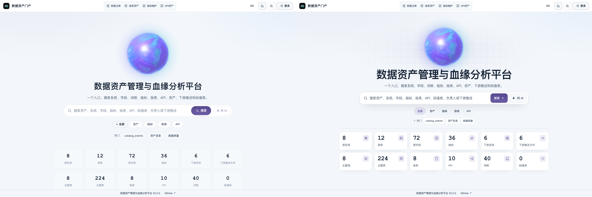
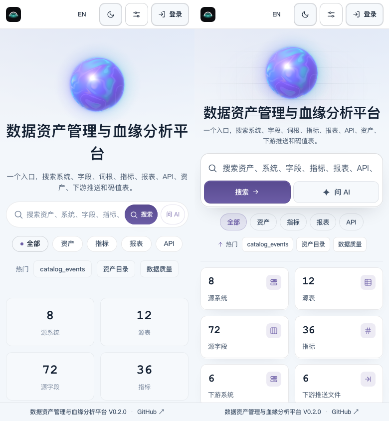

# DAP #597 浏览器截图

Playwright 在 Chromium 和 WebKit 中实际渲染。Remote API 与回答使用合成浏览器测试数据。

基线 `5dbaba5be5eeed79fd4638d7bab3a1a4adc07d15`，改造 `5a8a567cfd0436d160d4c2474102134e98041176`。

对照图左侧为改造前，右侧为改造后。

| 场景 | Chromium | WebKit |
| --- | --- | --- |
| 桌面浅色 · 12 项 Remote 统计 | [前](chromium/before/desktop-light.png) · [后](chromium/after/desktop-light.png) | [前](webkit/before/desktop-light.png) · [后](webkit/after/desktop-light.png) |
| 桌面深色 · 12 项 Remote 统计 | [前](chromium/before/desktop-dark.png) · [后](chromium/after/desktop-dark.png) | [前](webkit/before/desktop-dark.png) · [后](webkit/after/desktop-dark.png) |
| 390px 首页 | [前](chromium/before/mobile-390.png) · [后](chromium/after/mobile-390.png) | [前](webkit/before/mobile-390.png) · [后](webkit/after/mobile-390.png) |
| 320px 首页 | [前](chromium/before/mobile-320.png) · [后](chromium/after/mobile-320.png) | [前](webkit/before/mobile-320.png) · [后](webkit/after/mobile-320.png) |
| Compact · Blue / 深色 | [前](chromium/before/compact.png) · [后](chromium/after/compact.png) | [前](webkit/before/compact.png) · [后](webkit/after/compact.png) |
| 传统搜索结果 | [前](chromium/before/search.png) · [后](chromium/after/search.png) | [前](webkit/before/search.png) · [后](webkit/after/search.png) |
| Ask AI 桌面回答 | [前](chromium/before/ask-ai.png) · [后](chromium/after/ask-ai.png) | [前](webkit/before/ask-ai.png) · [后](webkit/after/ask-ai.png) |
| Ask AI 移动回答 | [前](chromium/before/ask-ai-mobile.png) · [后](chromium/after/ask-ai-mobile.png) | [前](webkit/before/ask-ai-mobile.png) · [后](webkit/after/ask-ai-mobile.png) |
