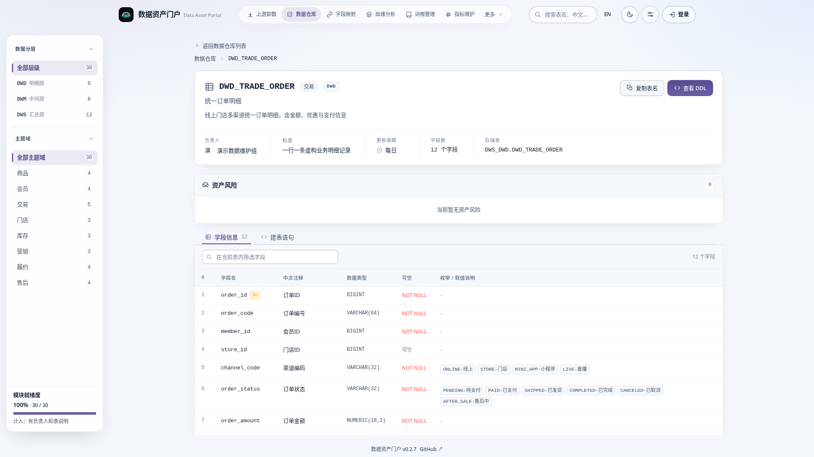
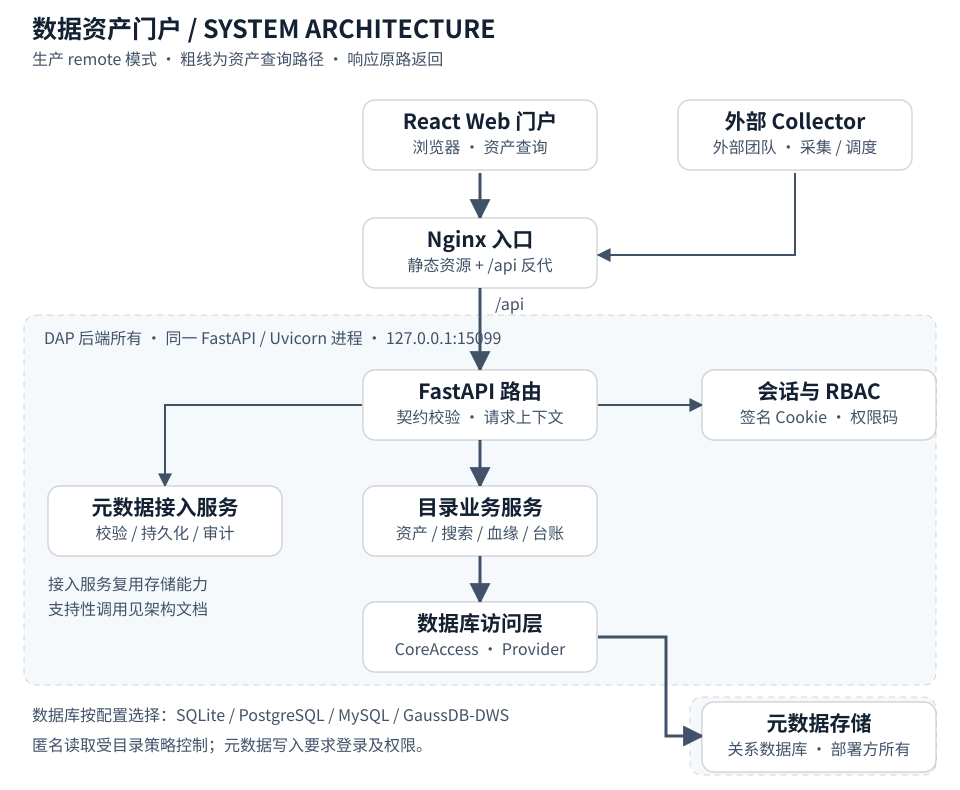

<div align="center">

# 数据资产门户 · Data Asset Portal (DAP)

**面向数据仓库团队的轻量级数据资产目录 —— 单机、内网、离线环境即刻可用。**

A lightweight, intranet-ready data asset catalog built for data warehouse teams.

[](./LICENSE)
[](https://github.com/0verme/data-asset-portal-community/actions/workflows/ci.yml)


**[🌐 在线演示 (Live Demo)](https://data.overme.cn/)** · **[📖 官方网站](https://dap.overme.cn)** · **[🚀 快速开始](#-快速开始)** · **[🧩 核心功能](#-核心功能)** · **[🏗 架构与接入](#-架构与元数据接入)** · **[📚 文档导航](#-文档导航)**

</div>

---

## 💡 为什么选择 DAP？

数据仓库、数据治理与 BI 团队每天都在回答四个高频问题：**表在哪？字段是什么意思？指标口径从哪来？数据流向了哪些下游和报表？**

当元数据散落在 Excel、Wiki 和建表脚本里时，查找与维护成本会随表规模迅速膨胀；而引入一套重型企业级元数据平台，又往往面临多组件运维（消息队列、独立搜索引擎、图数据库）与内网离线环境的部署门槛。

> **DAP 专注把「数仓资产目录」这一件事做好：用一个 Web 服务 + 一个关系型数据库，让数仓资产可见、可查、可维护。**

| 典型场景 | DAP 的产品主张 |
| --- | --- |
| **小团队 / 独立数仓团队** | 一个 Web 服务 + 一个数据库即可上线，无需额外部署 Kafka 或 Elasticsearch；默认内置确定性关键词检索 |
| **内网 / 离线环境** | 原生适配无外网的单机部署（systemd + Nginx，详见 [部署说明](./DEPLOYMENT.md)） |
| **以数仓建模与治理为核心** | 表分层、字段字典、物理 DDL、词根规范、指标口径、字段映射、血缘视图、码值表、报表与 API 台账均为一等公民 |
| **已有采集/ETL，只缺资产目录** | 通过版本化 [Metadata Ingestion Contract](./docs/metadata-ingestion.md) 接入外部已整理的元数据，零侵入现有生产链路 |
| **企业常见关系型数据库** | PostgreSQL、MySQL 8.0、SQLite（本地/Demo）均通过自动化验证，并提供 GaussDB / DWS 适配支持 |
| **已有 RAG 服务或 LLM 网关** | 按需可选挂载外部语义推荐与单轮 AI 资产问答；DAP 仅做轻量 HTTP Client，不接也完全可用 |

---

## 📸 界面预览

<table>
  <tr>
    <td width="50%" valign="top" align="center">
      
      <br><sub><b>全局资产搜索与发现</b> —— 跨表、字段、词根、指标、报表与 API 聚合检索，支持搜索与 AI 问答双 Tab 协同</sub>
    </td>
    <td width="50%" valign="top" align="center">
      
      <br><sub><b>数据仓库资产目录</b> —— 按数仓分层与主题域浏览表资产、落库状态与核心统计</sub>
    </td>
  </tr>
  <tr>
    <td width="50%" valign="top" align="center">
      
      <br><sub><b>资产详情与字段字典</b> —— 一站式查阅字段业务释义、技术属性、建表 DDL 与关联引用</sub>
    </td>
    <td width="50%" valign="top" align="center">
      
      <br><sub><b>字段级映射追踪</b> —— 清晰维护源表到目标表的字段加工规则、转换逻辑与来源系统映射</sub>
    </td>
  </tr>
</table>

> 👉 无需注册即可直接访问 **[在线演示站 (https://data.overme.cn/)](https://data.overme.cn/)** 浏览公开资产目录，或查看 [全量界面截图画廊](./docs/screenshots.md)。

---

## 🧩 核心功能

仓库内所有业务模块均以 Apache-2.0 协议开源，默认注册、开箱即用：

- **📊 数仓资产目录与字段映射**
  - **门户首页与数据仓库**：聚合展示全站资产统计、分类导航、表级/字段级元数据与物理 DDL。
  - **字段映射（Field Mapping）**：维护跨系统、跨数仓分层的字段级来源、映射关系与加工转换口径。
  - **血缘浏览（Lineage Viewer）**：对已导入的血缘快照提供上下游拓扑可视化、多跳路径过滤与影响查看（详见 [血缘快照采集与发布指南](./docs/lineage_bulk_import_guide.md)）。
- **📐 数据标准与指标口径**
  - **词根管理**：维护标准命名词根与英文缩写规范，辅助数仓建模命名对齐。
  - **指标资产**：沉淀业务指标定义、计算口径、加工路径与关联表归属。
  - **码值表维护**：集中管理公共枚举字典与标准码值映射，消除跨系统编码歧义。
- **🔄 上下游与消费端台账**
  - **上游卸数 & 下游推送**：统一登记外部源系统连接元数据、卸数配置与下游数据推送台账。
  - **报表资产 & API 资产**：将 BI 报表与数据服务接口纳入统一目录，打通「源系统 → 数仓表 → 指标 → 报表/API」全链路资产台账。
- **🔎 统一搜索与可选 AI 协同**
  - **确定性全局检索**：聚合所有已注册资产实体，支持分组筛选、字段级命中高亮与部分模块容错返回。
  - **搜索页双 Tab 协同**：「搜索结果」与可选的「AI 问答」并存于同一页面，按稳定 `assetId` / `fieldId` 去重并支持一键下钻资产详情。
- **🔐 分级公开目录（Public Catalog）与 RBAC 权限**
  - **匿名只读目录**：默认支持匿名浏览脱敏后的公开业务目录与检索；通过 `PUBLIC_CATALOG_PROFILE`（`internal` / `strict` / `disabled`）灵活控制连接定位元数据的可见性与匿名访问开关（详见 [Public Catalog + Authenticated Management](./docs/rbac/authenticated-read-model.md)）。
  - **受控管理后台**：所有写操作、元数据导入、凭据信息及系统管理（用户、角色、权限码绑定、菜单配置、参数字典、操作日志）均由后端 Permission-based RBAC 强制鉴权。

完整的页面路由、API 入口与数据库表对照请参阅 [模块清单](./docs/modules.md)。

---

## 🚀 快速开始

### 方式一：在线演示（Public Demo，零安装即刻体验）

直接访问 **[https://data.overme.cn/](https://data.overme.cn/)** 即可匿名浏览仓库内置的「全渠道零售数仓」演示数据集，体验全局搜索、表详情、字段映射、指标口径与血缘视图。

- 该站点由部署方独立运维，**使用真实 DAP 后端和 Remote API**（Nginx 托管前端静态资源并反代 `/api` 至 FastAPI 后端），不属于纯前端静态 Mock；
- 演示数据每日 04:00（Asia/Shanghai）自动重建重置；
- 公网演示站的管理员认证配置以及可选 AI / RAG 连接由部署方独立维护，本文档不公布公网管理密码。

### 方式二：本地一键启动 Community Demo（推荐完整体验）

环境要求：`Python 3.10+`、`Node.js 22.13+`、`npm 10+`。执行以下脚本将自动初始化本地 SQLite 演示库、灌入演示数据并启动前后端服务：

```bash
# Linux / macOS
./scripts/demo.sh
```

```powershell
# Windows PowerShell
.\scripts\demo.ps1
```

按终端输出的地址打开浏览器后，既可匿名浏览公开目录，也可使用本地演示管理员账号登录体验后台管理：

- **用户名 / 密码**：`admin` / `123456`
- *注：该默认账号仅适用于本地 Community Demo 与开发体验；生产部署不提供默认管理员密码，请使用 `backend/scripts/create_admin.py` 交互创建。更多数据库初始化方式见 [Community Demo 指南](./docs/community-demo.md)。*

### 方式三：纯前端 Mock 模式（无需 Python 与数据库）

如果只想快速预览前端 UI 或调试前端样式，只需 `Node.js 22.13+`：

```bash
npm --prefix frontend ci
VITE_API_MODE=mock npm --prefix frontend run dev
```

也可在 `frontend/.env.local` 中设置 `VITE_API_MODE=mock`，再使用演示账号 `admin` / `123456` 登录。前端 Mock 模式仅读取前端内置演示数据，其 AI 问答由本地演示适配器按名称/字段匹配生成，**不调用任何 RAG 服务或 LLM**（详见 [AI 问答静态 Mock 演示](./docs/ai-ask-static-mock.md)）。

---

## 🪶 产品边界与同类项目对比

**DAP 不试图替代 OpenMetadata、DataHub 或 Apache Atlas。**

如果你的团队需要数百个开箱即用的数据源 Connector、内置定时采集调度、SQL / DAG 自动血缘解析、数据质量 Profiling 或复杂治理工作流，OpenMetadata 或 DataHub 是更合适的选择。DAP 的取舍是在更聚焦的范围内，**用更少的组件和更低的运维成本交付一个数仓资产目录**。

| 维度 | DAP | OpenMetadata | DataHub |
| --- | --- | --- | --- |
| **核心定位** | 轻量级数仓资产目录 | 统一元数据平台（含治理闭环） | 企业级元数据平台 |
| **部署形态** | Web 服务 + 单个关系型数据库，易于单机内网部署 | 多服务：元数据服务 + Ingestion + 索引/存储依赖 | 多组件：元数据服务 + 消息/索引/存储依赖 |
| **运维复杂度** | 低（小团队友好） | 中高 | 中高 |
| **离线 / 内网单机部署** | 核心支持场景 | 可行，但依赖组件更多 | 可行，但依赖组件更多 |
| **内置采集器与自动调度** | 不内置（通过版本化 Ingestion API 接收外部导入） | 丰富 | 丰富 |
| **血缘能力** | 展示外部导入的血缘快照（Lineage Viewer） | 内置自动血缘解析 | 内置自动血缘解析 |
| **数据质量 / Profiling** | 不提供 | 提供 | 提供（随版本与配置） |
| **治理与安全边界** | 分级公开目录 + Permission RBAC + 操作审计日志 | 目录 + 质量 + 血缘 + 词汇表 + 策略 | 目录 + 血缘 + 策略与元数据自动化 |

### DAP 明确委托给外部系统的边界

为保持核心轻量与内网易部署，以下职责由外部系统或可选集成承担，**不在 DAP Core 内置范围内**：

- **数据采集与任务调度外置**：DAP 不主动扫描业务数据库、不承担 ETL 编排或真实下游文件推送执行；由现有治理程序或 ETL 平台整理好元数据后通过 API 导入。
- **血缘解析外置**：DAP 不内置 SQL / DAG 自动血缘解析引擎，仅接收、校验并可视化展示已导入的 self-contained 血缘快照。
- **向量引擎与模型推理外置**：DAP **不内置**向量数据库、Embedding 模型推理，也不提供自然语言转 SQL（NL2SQL）或可执行问数引擎；相关资产推荐与 AI 问答均作为**可选**的外部 HTTP 服务接入。
- **高级 IAM 与数据质量外置**：当前不包含多角色叠加/ABAC/行级数据范围授权、外部 SSO/IAM 以及数据质量 Profiling。

---

## 🏗 架构与元数据接入



后端所有模块运行在同一 FastAPI 进程内；详细分层、归属边界与交互架构图请参阅 [架构说明](./docs/architecture.md)。

| 层级 | 技术栈与职责 |
| --- | --- |
| **前端（Frontend）** | React 19 + Vite 8 + TypeScript（`frontend/src/` 全量采用严格类型检查，关闭 JS fallback） |
| **后端（Backend）** | FastAPI + Uvicorn（唯一运行入口 `backend/asgi.py`，本地/生产启动示例：`uvicorn backend.asgi:app --host 127.0.0.1 --port 15099`，进程探针 `GET /healthz`） |
| **数据访问层（Data Access）** | Service Layer → Database Provider → SQLite / PostgreSQL / MySQL 8.0 / GaussDB-DWS |
| **部署形态（Deployment）** | Nginx 托管前端静态产物并反向代理 `/api`（涵盖 Linux systemd 单机部署与 [Windows 内网 npm 镜像构建流程](./DEPLOYMENT.md#73-windows-内网-npm-镜像构建与部署issue-468)，详见 [部署说明](./DEPLOYMENT.md)） |

### 契约式元数据接入（Metadata Ingestion）

```text
External System (ETL / 数据治理脚本 / lakehouse-toolkit)
    ──▶ 已整理的 Metadata JSON ──▶ DAP Metadata Contract (/api) ──▶ 校验 · 归一化 · 幂等持久化 · 审计 · 目录展示
```

- **外部系统负责**：数据源连接、筛选、资产识别、血缘解析、定时调度与失败重试；
- **DAP 负责**：接收（Receive）、结构校验（Validate）、归一化（Normalize）、幂等更新（Idempotency）、持久化（Persist）、操作审计（Audit）与目录展示（Expose）。

只需几分钟即可从一份 JSON 完成首次资产导入：请参考 [Metadata API 最小资产导入 Demo](./examples/metadata_ingestion/README.md) 与示例载荷 [assets.example.json](./examples/metadata_ingestion/assets.example.json)。完整字段语义见 [Metadata Ingestion Contract](./docs/metadata-ingestion.md) 与 [ADR-001](./docs/adr/001-metadata-ingestion-contract.md)。

---

## 🔎 搜索与可选 AI 能力

DAP 提供三条互不干扰的检索与问答路径，**默认仅开启传统关键词搜索**：

| 能力路径 | 前端入口 | 后端接口 | 默认状态 | 外部依赖 |
| --- | --- | --- | --- | --- |
| **传统关键词搜索** | 全局搜索框、结果页「搜索结果」Tab | `GET /api/search` | **默认可用** | 无（进程内完成，**不依赖 RAG**，也**不依赖 LLM**） |
| **可选 RAG 相关资产推荐** | 结果页「相关资产推荐」分组 | `GET /api/search/recommendations` | **默认关闭** | 可选外部 RAG HTTP 服务 |
| **可选单轮 AI 资产问答** | 结果页「AI 问答」Tab、「问 AI 找资产」 | UI 使用 `POST /api/ai/ask/stream`；`POST /api/ai/ask`、`POST /api/ai/ask/progress` 为兼容接口；`GET /api/ai/status` 提供能力开关 | **默认关闭** | 上述 RAG 服务 + 可选 OpenAI-compatible LLM |

### 核心设计原则

1. **默认关闭，故障零传染**：`AI_ASK_ENABLED` 默认 `false`（Community Demo 与前端 Mock 模式均不会自动连接真实 AI）。只有当该开关开启、LLM Provider 配置完整且 RAG 服务与 Token 就绪时，`GET /api/ai/status` 才返回启用状态；未启用或外部服务超时，前端自动隐藏入口或仅降级推荐分组，绝不影响传统关键词检索。
2. **目录权威校验（防幻觉）**：DAP 仅作为 HTTP Client 调用外部 `dap-rag-lab` 检索服务与 OpenAI-compatible 模型端点。远端与模型只能返回候选稳定 `assetId` / `fieldId`；最终展示的表名、字段名、中文描述和引用卡全部由 DAP 按当前 `PUBLIC_CATALOG_PROFILE` 回查自身元数据库重建，模型无法编造不存在的资产。
3. **额度管控与契约边界**：内置全站每日默认问答额度控制、SSE 阶段进度反馈与受控目录统计意图。目前仓库 `main` 的 CI 自动化覆盖全部接口契约、鉴权与降级行为，外部 RAG / LLM 端点的真实联调验收与回答质量由各部署方按实际环境配置验证。完整配置、状态语义与路线图详见 [单轮 AI 数据资产问答](./docs/ai-ask-mvp.md)、[权威资产目录统计](./docs/ai-metadata-count.md)、[智能问数与语义推荐路线](./docs/semantic-recommendation-roadmap.md)、[后端配置](./docs/configuration.md) 及 [部署说明](./DEPLOYMENT.md#36-optional-single-turn-ai-asset-qa)。

---

## 🗄 数据库兼容性

DAP 使用两个等级界定数据库支持范围：

- **Verified**：有可复现的自动化测试与 CI 任务覆盖（含真实数据库实例或标准本地回归路径）。
- **Compatible**：代码与 DDL 层面提供方言适配及离线静态校验，无在线 CI 实例回归。

| 数据库 | Runtime | Migration | CI 验证等级 | 说明 |
| --- | --- | --- | --- | --- |
| **SQLite** | Verified | Verified | **Verified** | 本地开发、一键 Community Demo 与基础 CI 默认库；**非生产环境目标** |
| **PostgreSQL** | Verified | Verified | **Verified（PG 16 实例）** | 覆盖空库迁移 → 演示数据灌入 → 全量后端集成测试 → 重复迁移幂等校验 |
| **MySQL 8.0** | Verified | Verified | **Verified（MySQL 8 实例）** | 覆盖基线迁移/校验 + SQLAlchemy Core CRUD、分页、唯一约束、事务回滚与幂等契约 |
| **GaussDB / DWS** | Compatible | Compatible（离线静态 DDL） | **Static verification only** | CI 仅执行 `schema_migrate.py verify --offline --dialect dws`；生产部署需由部署方自备对应 JVM 版本的商业 JDBC 驱动 |
| **Cloudflare D1** | 不支持 | — | — | 无适配器，且不在支持计划内 |

完整兼容矩阵、验证命令与迁移运维规范请参阅 [数据库支持矩阵](./docs/database-support.md) 与 [数据库迁移指南](./backend/schema/README.md)。

---

## 📚 文档导航

### 使用与部署

| 文档 | 内容说明 |
| --- | --- |
| [Community Demo 指南](./docs/community-demo.md) | SQLite / PostgreSQL 演示环境初始化与重置流程 |
| [部署说明](./DEPLOYMENT.md) | Linux 单机生产部署、systemd、Nginx、HTTPS、可选 AI 配置与 Windows 内网构建 |
| [后端配置](./docs/configuration.md) | 环境变量命名空间、Public Catalog profile、可选 RAG / AI 参数与默认值 |
| [数据库支持矩阵](./docs/database-support.md) | Verified / Compatible 分层说明与各数据库验证边界 |
| [数据库迁移](./backend/schema/README.md) | Alembic baseline、stamp 与 forward migration 运维规则 |
| [Metadata Ingestion Contract](./docs/metadata-ingestion.md) | 外部元数据导入规范、版本幂等、血缘快照契约与请求示例 |
| [截图画廊](./docs/screenshots.md) | Community Demo 全量模块界面截图 |

### 架构与设计

| 文档 | 内容说明 |
| --- | --- |
| [架构说明](./docs/architecture.md) | 前后端分层架构、数据流向与组件边界（含交互式架构图入口） |
| [模块清单](./docs/modules.md) | 前端页面、后端接口路由与数据库表全量对照表 |
| [API 契约](./docs/api-contract.md) | REST API 约定、端点清单与请求/响应模型 |
| [Public Catalog + RBAC 读模型](./docs/rbac/authenticated-read-model.md) | 匿名公开目录脱敏级别与受保护路由分类 |
| [ADR-001](./docs/adr/001-metadata-ingestion-contract.md) | Metadata Ingestion Contract 架构决策记录 |
| [单轮 AI 数据资产问答](./docs/ai-ask-mvp.md) | AI 问答接口契约、状态语义、额度控制与验收边界 |
| [权威资产目录统计](./docs/ai-metadata-count.md) | 表数 / 字段数统计意图识别、歧义处理与失败降级 |
| [AI 问答静态 Mock 演示](./docs/ai-ask-static-mock.md) | 前端 Mock 模式（`VITE_API_MODE=mock`）本地适配器与隔离约束 |
| [智能问数与语义推荐](./docs/semantic-recommendation-roadmap.md) | 语义推荐底座与演进路线图 |
| [资产风险联动设计](./docs/asset-risk-integration-design.md) | 外部审计结果接入边界与设计提案 |
| [待确认事项](./docs/todo.md) | 当前待决策事项与阶段性规划 |
| [更新日志](./CHANGELOG.md) | 各版本功能演进与变更记录 |

### 参与贡献与开发

| 文档 | 内容说明 |
| --- | --- |
| [开发指南](./DEVELOPMENT.md) | 本地前后端联调、环境变量与完整测试矩阵 |
| [首次贡献指南](./docs/first-contribution.md) | 从 Fork、分支创建、本地自测到提交 PR 的快速指引 |
| [Good First Issue 提案](./docs/good-first-issues.md) | 面向新贡献者的清晰边界任务清单 |
| [贡献指南](./CONTRIBUTING.md) | Issue / PR 规范、代码风格、发布检查与标签语义 |
| [工程历史归档](./docs/archive/engineering-history/README.md) | 已完成架构迁移阶段的工程档案，供维护者溯源参考 |

---

## 🙋 常见问题

### 1. `mock` 模式和 `remote` 模式有什么区别？

`VITE_API_MODE=mock` 仅读取前端内置演示数据，无需启动 Python 后端与数据库，使用演示账号 `admin` / `123456` 登录，其 AI 问答由前端本地适配器生成；`remote` 模式通过 `/api` 访问真实 FastAPI 后端与数据库，不会回退到 Mock。公网在线演示站 [https://data.overme.cn/](https://data.overme.cn/) 运行在 `remote` 模式下。

### 2. 在线演示站使用真实 AI 问答吗？

在线演示站是真实后端 + Remote API 的独立部署，非静态 Mock。其 AI 问答是否启用、连接哪个 RAG 服务与 LLM Provider 由该站点的部署配置决定（当前部署已接入外部 RAG 检索与 OpenAI-compatible LLM Provider，具体模型与可用性随部署调整）。仓库 Community 默认配置仍保持 `AI_ASK_ENABLED=false`，自建部署需按 [部署说明](./DEPLOYMENT.md) 与 [后端配置](./docs/configuration.md) 自行配置并验证。

### 3. 如何把我们团队现有的数仓表和血缘导入 DAP？

DAP 不直接连库扫描你的业务数仓。你可以用现有的 Python 脚本、ETL 任务或治理工具将表结构、字段映射与血缘关系整理为标准 JSON，调用 DAP 的 Metadata Ingestion API 完成幂等导入。可先参考 [Metadata API 最小资产导入 Demo](./examples/metadata_ingestion/README.md) 在几分钟内跑通首次导入。

---

## 🤝 社区与许可证

- **交流与提问** → [GitHub Discussions · Q&A](https://github.com/0verme/data-asset-portal-community/discussions/categories/q-a)
- **反馈 Bug** → [Bug Report Issue Form](https://github.com/0verme/data-asset-portal-community/issues/new?template=bug_report.yml)
- **参与代码贡献** → [Good First Issues](https://github.com/0verme/data-asset-portal-community/issues?q=is%3Aissue+is%3Aopen+label%3A%22good+first+issue%22) · [首次贡献指南](./docs/first-contribution.md) · [CONTRIBUTING.md](./CONTRIBUTING.md)
- **报告安全漏洞** → 请阅读 [SECURITY.md](./SECURITY.md) 并通过 GitHub Private Vulnerability Reporting 私密提交，切勿在公开 Issue 或 Discussion 中披露。

本项目基于 **[Apache License 2.0](./LICENSE)** 开源，第三方组件归属说明见 [NOTICE](./NOTICE)。

Copyright 2025 Jearhe ([overme.cn](https://dap.overme.cn))
