# 📸 界面截图画廊

> 以下截图于 2026-11-25 拍摄自线上演示站 **data.overme.cn**（v0.2.7，暮光紫主题色），
> 基于 `2560×1440` 视口。站内数据为虚构零售演示数据，每日自动重置。
> 此前画廊截图为 V0.1.0 旧界面，已整体替换；界面继续演进时截图会再次过期，请以线上站为准。

## 资产门户总览

首页聚合全部数据资产类型与统计，是进入平台的第一屏。

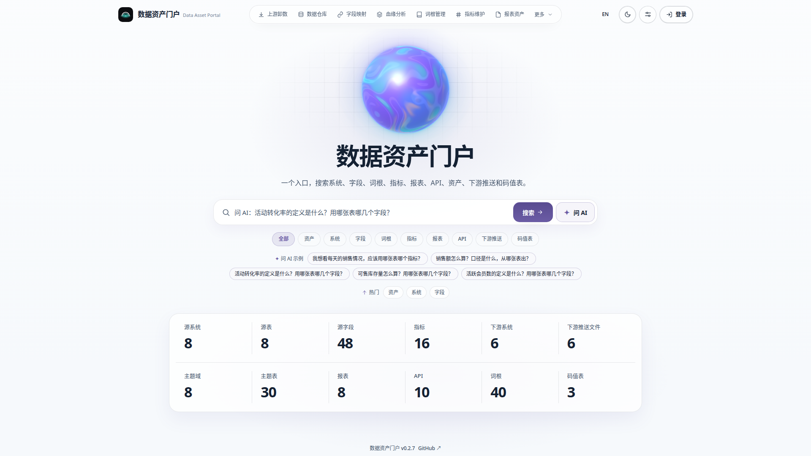

## 数据资产（主题表）

30 张主题表按 DWD / DWM / DWS 分层，覆盖 8 个主题域，含中文名、负责人与字段数。

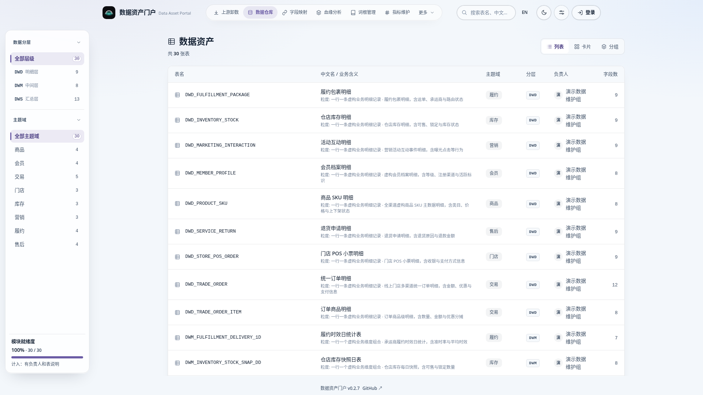

## 表资产详情

表基本信息、字段元数据（中文名 / 类型 / 主键 / 分区 / 枚举说明）与资产风险一目了然。

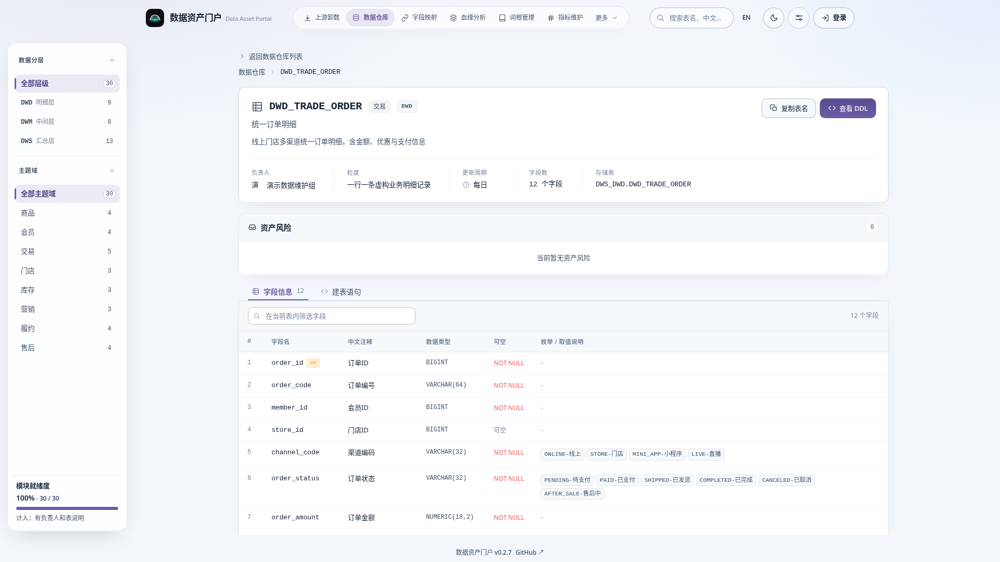

## 表 DDL

自动生成建表语句与字段注释（PostgreSQL 方言），支持一键复制。

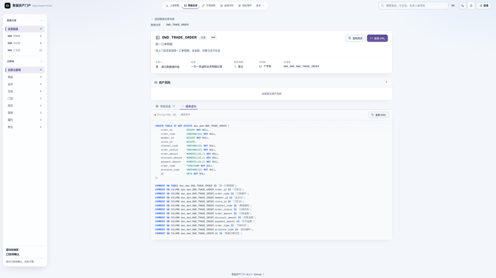

## 统一搜索

一个关键词可跨 **资产 / 字段 / 词根 / 指标 / API** 统一发现，并标注命中位置。

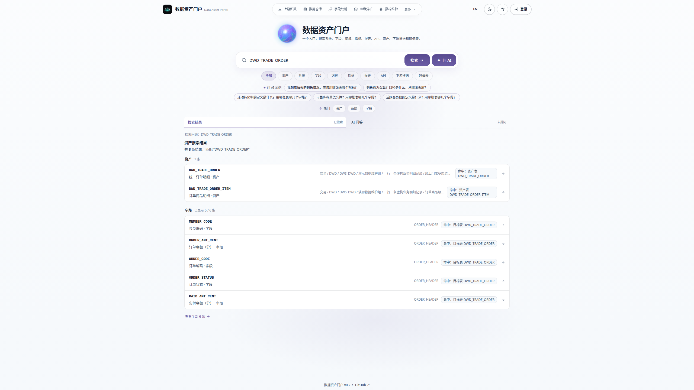

## AI 问答

输入业务问题，问 AI 给出执行过程、命中资产与已核实来源，直接定位到表和字段。

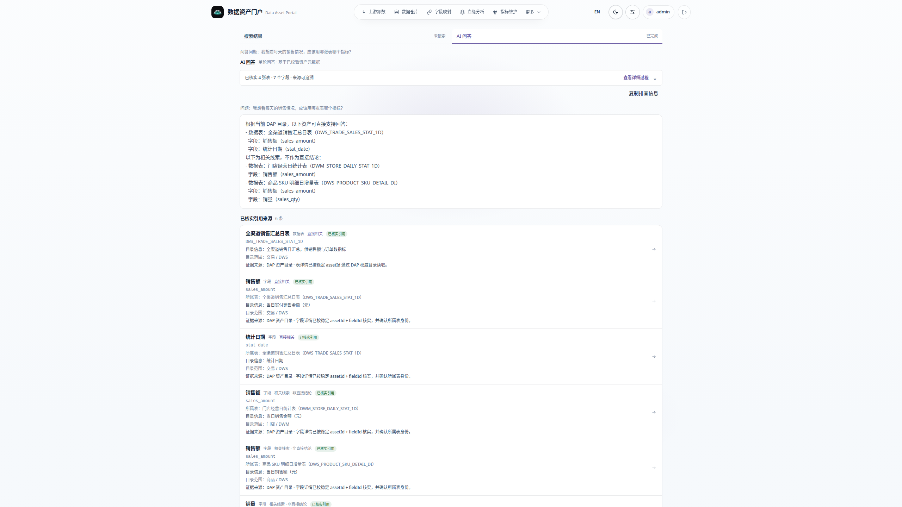

## 字段映射

源系统表 → DWD 目标表的字段映射，8 个源系统、48 个字段 100% 覆盖。

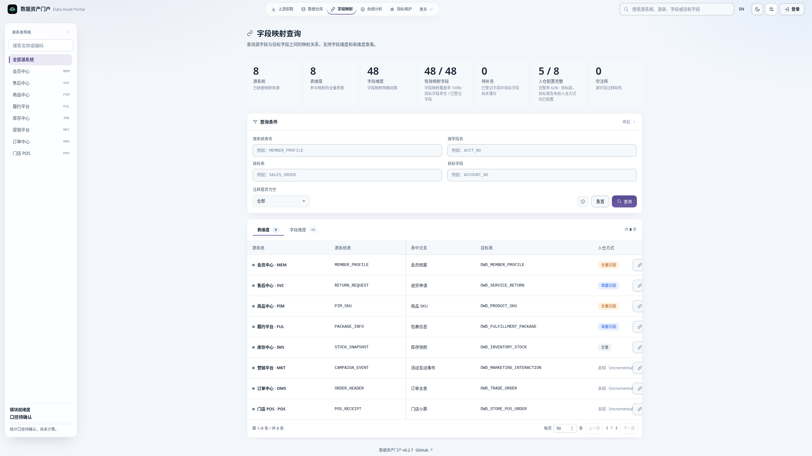

## 数据标准（词根）

40 个零售标准词根，用于拼装表名与字段名。

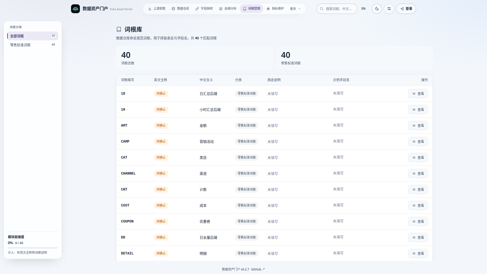

## 指标维护

16 个口径指标，覆盖商品 / 会员 / 交易 / 门店 / 库存 / 营销 / 履约 / 售后八大零售维度，
每个指标均关联结果表与指标路径。

维度目录不是前端静态清单：侧边栏由 `GET /api/indicators/dimensions` 从真实指标数据自动发现，
所以同一套页面在内网接入客户 / 员工 / 借据 / 合同 / 机构等真实业务维度时无需改代码。

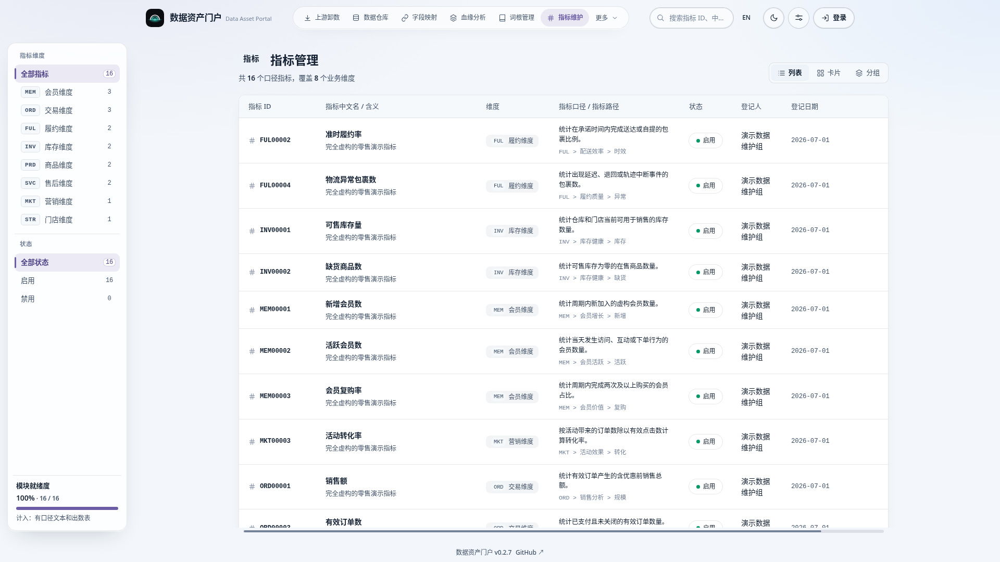

## 上游卸数

8 个源系统接入卡片，含连接状态、卸数周期与最近运行结果。

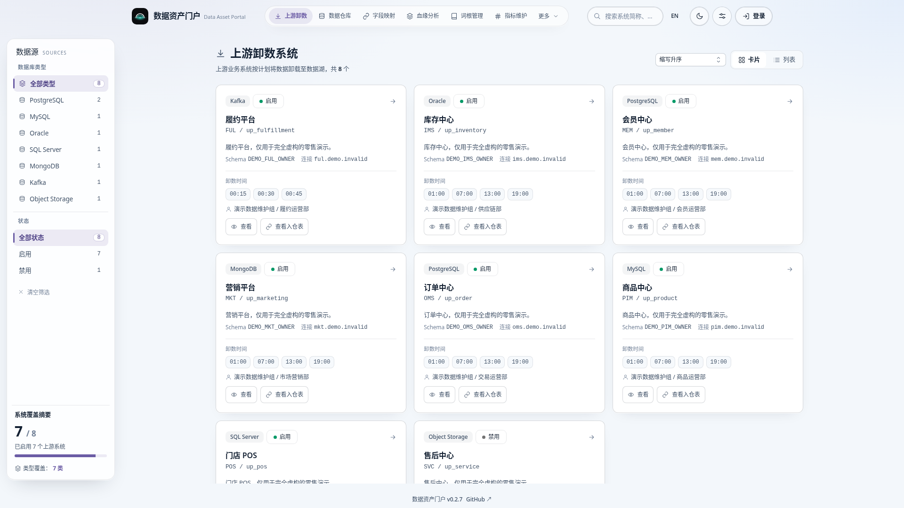

## 血缘分析

以 DWD_TRADE_ORDER 为中心的上下游血缘图与节点详情（快照 demo-lineage-20260712-001）。

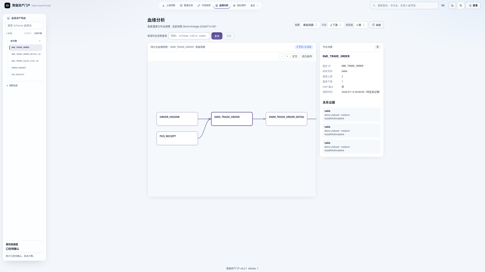

## 报表资产

8 张报表资产，含所属部门、负责人、用途与血缘表数。

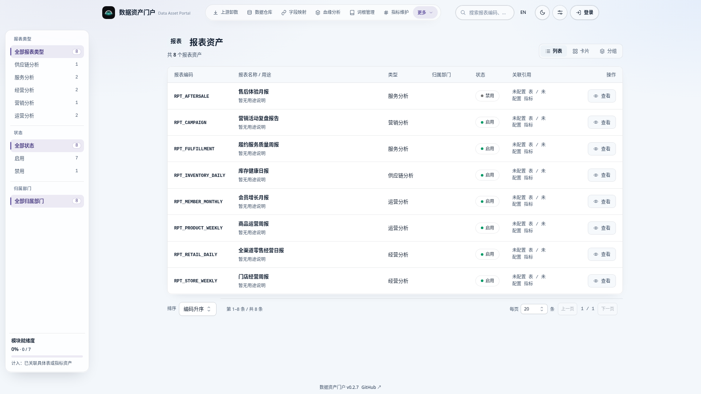

## API 资产

10 个数据服务 API，含方法、路径、归属系统与负责人。

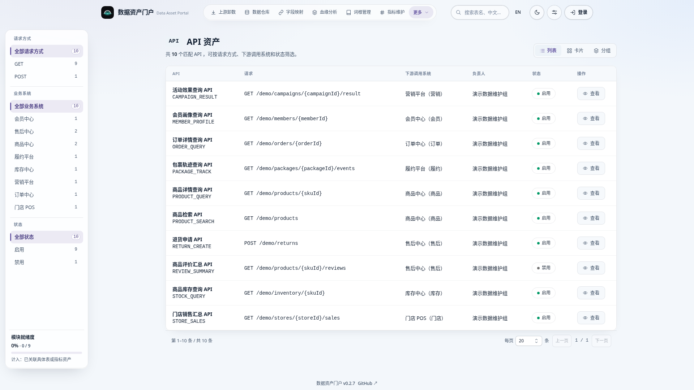

## 下游推送

6 个下游系统与 6 个推送文件，含协议、频率与最近状态。

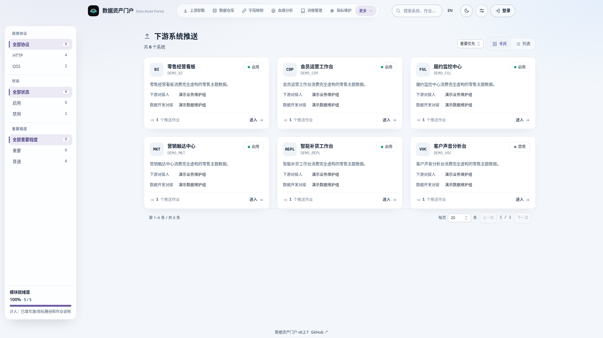

## 码值表维护

3 张码值表（渠道、会员等级、订单状态），含字段结构与启用行数。

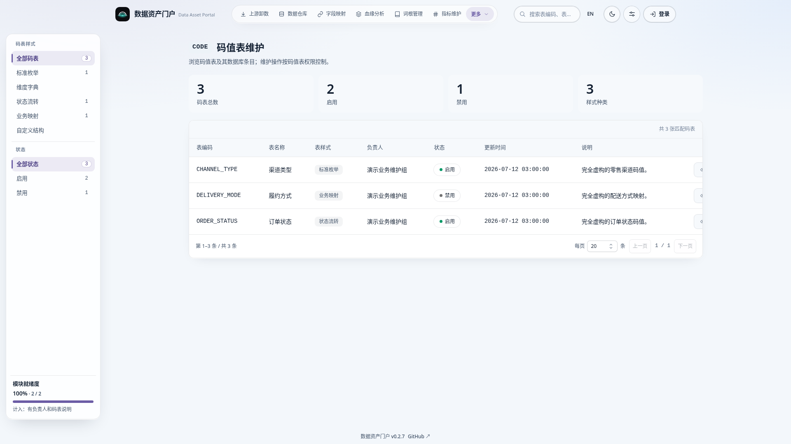

## 系统管理 · 参数字典

11 类参数字典、49 项字典值统一维护（需以 Community Demo 演示账号登录）。

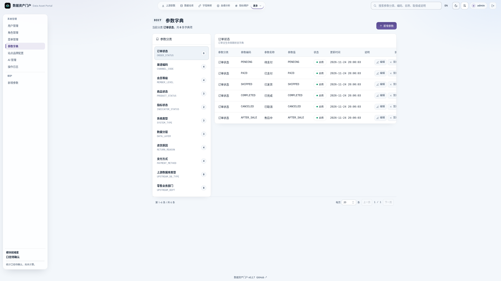

---

## 说明

- 所有数据均为**虚构零售演示数据**，不包含任何真实业务信息。
- 截图来自线上演示站 data.overme.cn（v0.2.7），保留拍摄时的页脚版本与主题色（暮光紫，为本地外观设置；演示站默认主题为翠绿）。
- 参数字典截图以演示管理员账号登录拍摄，其余截图为访客态（问 AI 不需要登录即可使用）。
